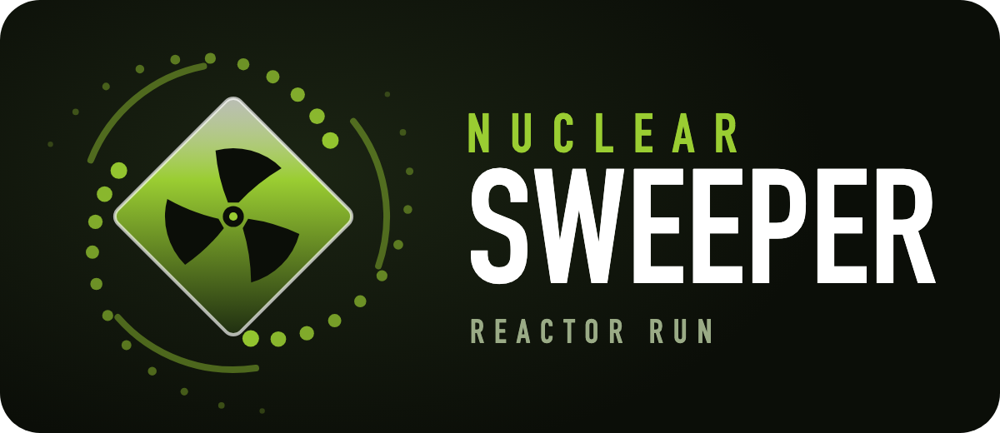

# Nuclear Sweeper

## Mouse side buttons and collection audio

In **Settings / Key bindings**, select an action and press a keyboard key or
either mouse side button (**Mouse 4 / Back**, **Mouse 5 / Forward**) to bind it.
Left-click fire and right-click aim stay fixed. Dust collection plays a subtle
pickup sound, controlled by the existing Effects and Master volume sliders.

## Collaboration

See [roadmap.md](roadmap.md) for priorities, task ownership, and the workflow for
coordinating issues and pull requests across developers.

## Ammunition

Each weapon starts with a loaded magazine and **3 spare reloads**. Every completed
reload uses one spare, including partial-magazine reloads. Switching weapons
cancels an unfinished reload without spending a spare. Only returning to the
shelter refills magazines and reserves; remote blue depots accept dust only.
Buy **Ammo pouch** under Gear with scrap to carry one additional reload per
weapon per level (10 levels, up to 13 spares). Each weapon's Extended mags upgrade
also increases the size of its spare magazines. The HUD shows spare reloads and
warns when the selected weapon is out of ammo.

## HUD and shelter navigation

The shelter header shows your three currencies and where each one comes from
(credits from refined dust, scrap from enemies, rare parts from the vault and
the pool island). Below it, four tabs; each tab shows how many upgrades you can
buy right now:
- **Weapons:** a gunsmith for the selected weapon (silhouette, damage / fire rate /
  magazine / reload bars, unlock or mastery progress), attachment unlocks (parts,
  once for all weapons) and equip toggles, and the weapon's own upgrades (credits).
  Weapon damage, cyclic rate and extended mags are levelled per weapon, so every
  gun is its own upgrade track. Saves from before keep their old shared level on
  every weapon.
- **Gear:** gear upgrades (scrap), station upgrades (credits), and movement modules (parts).
- **Achievements:** lifetime cleanup and combat milestones.
- **Score:** current run, records, and the local top 5. Score is not a currency.

Progress is stored in the browser (localStorage). Settings → Save game exports a
backup file (game state plus settings) and imports it again after checking the
map data; importing replaces the current progress and reloads the page.

Upgrades are icon tiles with a level bar and a price button. Upgrades you cannot
afford yet stay readable and show how much is missing.

Overview and radio stay visible below every tab, alongside the exit actions.
Use the radio's Previous / Next buttons to read every transmission. Cards use
the available screen width, with adaptive pages on smaller screens. Purchases
keep your selected tab and page. Settings retains its separate categories.

For a manual UI check, visit every category on desktop, portrait, and landscape
screens. Page through achievements, mastery, and key bindings; buy an upgrade,
equip an attachment, rebind a key, and resize with a menu open. Verify that
content stays reachable without scrolling and that leaving / settings still work.

## Progression

Open `nuclear-sweeper-reactor.html` in a browser to play. The shelter shows
weapon licenses, per-weapon mastery requirements, and lifetime achievements.

### Weapon licenses

Weapon classes unlock automatically through kills, not credits:

| Unlock | Kills with the previous class |
| --- | --- |
| MP7 and SMG-11 (machine pistols) | 25 pistol kills |
| 416-C and R4-C (assault rifles) | 60 machine-pistol kills |
| Breaker (shotgun) | 90 assault-rifle kills |
| Vector DMR (sniper / DMR) | 60 shotgun kills |

Variants contribute to a shared class total. These starting values target a
short introductory pistol phase and longer practice with automatic weapons;
the shotgun requirement is lower because of its slower firing and reloads.
They are initial tuning values, not a substitute for extended playtesting.
Credits still buy station and weapon-stat upgrades.

### Weapon mastery

Each weapon starts at Basic. All requirements in a row must be met with that
specific weapon; progress is cumulative and is never spent or reset on promotion.

| Finish | Total kills | Glowers | Spitters | Brutes | Gunners |
| --- | --- | --- | --- | --- | --- |
| Tier 1: Gold | 50 | 20 | 5 | 0 | 0 |
| Tier 2: Platin | 150 | 40 | 25 | 10 | 10 |
| Tier 3: Polychrome | 400 | 100 | 60 | 40 | 40 |

Mastery changes the weapon finish and weapon-slot border, not damage. Polychrome
cycles through colors. Weapon slots also show mastery and kill counts on hover.
Only the weapon delivering the killing hit receives credit. Shotgun pellets
cannot count the same enemy twice; despawning enemies never awards kills.

### Achievements and saves

- Lifetime dust removed: 500, 2,500, 10,000, and 50,000 units.
- Each enemy type: 10, 50, and 200 kills (16 achievements in total).
- Dust counts at collection, not delivery or refining; losing tank contents
  does not undo cleanup progress or count dust a second time.
- Progress survives death, site changes, and reloads. Reset save clears it.
- Existing saves retain purchased weapons. New statistics start at zero because
  old saves did not record lifetime dust or per-weapon/per-enemy kills.

### Combat score

- Each kill awards 100 points; a headshot killing hit adds 20 points.
- Kills within five seconds stack into one gold, right-side notification.
  After five gameplay seconds without a kill, it fades out over 0.4 seconds.
  Menus hide the notification and pause its timer.
- Every fifth kill raises the streak multiplier by 0.1, capped at 1.5.
  The new multiplier applies only to that kill and later kills, including their
  headshot bonus; previous points are never recalculated. Expiry resets the chain.
- The HUD shows current-run points and your personal best. Combat score in the
  shelter adds lifetime points, longest streak, and a local top-five leaderboard.
  A run ends on rescue (death) or deployment to the next site, not on entering
  the shelter. Reloading retains run points but starts a new streak.
- Score achievements reward 10,000 / 50,000 / 250,000 lifetime points; streak
  achievements reward chains of 5 / 10 / 25 kills. Points are for records and
  achievements, not currency, so combat scoring does not affect upgrade balance.
- Records are stored in this browser's save, not an online leaderboard. Existing
  saves start at zero points; reset save also clears scores and records.

### Validation

Browser checks cover fresh and legacy saves, exact unlock boundaries, combined
class counts, every mastery total/type gate, duplicate kill protection,
achievement deduplication, save/load round trips, and removal of credit unlocks.
For a manual check, inspect the shelter progress cards, earn kills with each
class, and verify that newly unlocked weapons can be selected with keys 1–7.

## Heavy-weapon collateral

Heavy rounds can hit enemies lined up behind the first target. Walls and other
solid cover still stop shots; enemies are hit at most once per round or pellet.

| Weapon | Maximum targets per round / pellet | Damage retained per penetration |
| --- | --- | --- |
| Desert Eagle, 416-C, R4-C | 2 | 60% |
| Breaker | 2 per pellet | 50% |
| Vector DMR | 3 | 75% |

MP7 and SMG-11 rounds stop at the first enemy. The Vector DMR also deals 2.5x
damage to large enemies (50 base body damage and 200 base brute headshot damage,
before upgrades, attachments, and penetration falloff).

See `MOVEMENT.md` for movement tuning and zipline controls.

## Room variety

New sites mix cargo storage, turbine halls, sample labs, service archives,
collapsed works, and open transfer atriums. Each has its own layout, floor
markings, and overhead sign. Layouts are seeded per site, with clear central
routes and the existing platforms, depots, reactor, shelter, and coolant pool.

Existing saves retain their current site's layout and cleanup progress. The new
room designs appear when deploying to the next site (or starting a fresh save).

## Developer version

Open the [developer version](nuclear-sweeper-dev.html) with the game HTML and `nuclear-sweeper-dev.js`
in the same folder. Press **F2** to open developer tools anywhere.

The developer version has its own save and settings. It includes every purchase,
max loadouts, site travel, location teleports, cleanup/refinery controls, enemy
spawning, and testing assists. See [DEVELOPMENT.md](DEVELOPMENT.md) for details.

Both versions require internet access to load Three.js.
